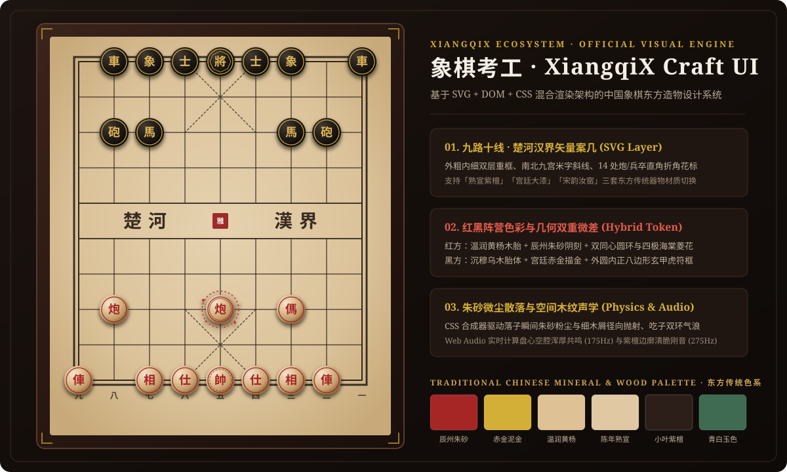
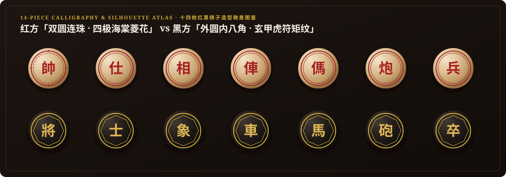
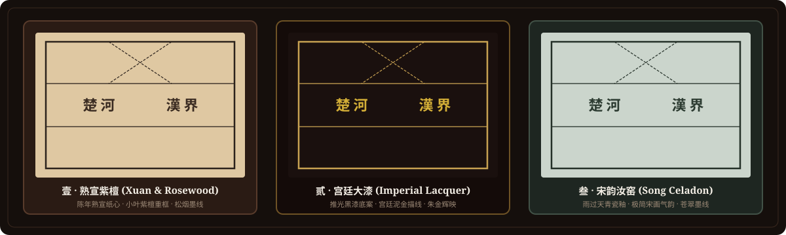

<div align="center">

# 象棋考工 · XiangqiX Craft UI (`xiangqix-craft`)

**中国象棋东方造物视觉与 SVG + DOM + CSS 混合渲染设计系统**  
*The Official Oriental Visual Design System & Hybrid SVG/CSS Board Engine for the **[XiangqiX](https://github.com/zpjio/xiangqix)** Ecosystem.*

[](https://github.com/zpjio/xiangqix-craft)
[-C8A252?style=flat-square&labelColor=1F1612)](https://github.com/zpjio/xiangqix)
[](./LICENSE)
[](#三层混合渲染架构-hybrid-rendering-architecture)
[](#四-对弈台交互与辅助分析特性)

<br />



</div>

---

## 一、 项目背景与 XiangqiX 生态矩阵

**象棋考工 (`xiangqix-craft`)** 是 **[XiangqiX](https://github.com/zpjio/xiangqix)**（中国象棋 AI 辅助分析与博弈推演系统）旗下的独立开源视觉与 UI 设计规范项目。

市面上绝大多数象棋界面或照搬**西方国际象棋（8×8 棋盘格与立柱剪影）**，或采用**高饱和欧美 SaaS 扁平风**，丧失了中国象棋流传千年的器物神韵。本项目以《考工记》造物精神与宋明文房木雕象棋为蓝本，完全基于原生前端技术（**SVG 矢量制式 + DOM 经纬交点拓扑 + CSS 旋木光影与微粒动画 + Web Audio 空间木音合成**）构建了一套零外部图片依赖、任意分辨率无损缩放的东方象棋视觉设计系统。

### 🏛️ XiangqiX 开源生态矩阵 (Ecosystem Matrix)

| 仓库项目 | 定位与职责 | 仓库地址 | 状态 |
| :--- | :--- | :--- | :--- |
| **象棋考工 · XiangqiX Craft UI** | 东方造物视觉规范、SVG+DOM+CSS 混合渲染棋盘、阴刻木雕棋子与空间木音引擎 | [`zpjio/xiangqix-craft`](https://github.com/zpjio/xiangqix-craft) | ✅ **已开源** |
| **XiangqiX · 象棋 AI 辅助系统** | 中国象棋 AI 实时拆解、深度算路辅助、局面库引擎与复盘推演主项目 | [`zpjio/xiangqix`](https://github.com/zpjio/xiangqix) | 🚧 **研发中 · 后期开源** |

> **核心设计禁令（Anti-Western Chess Clichés）**：
> - ❌ 严禁西方国际象棋黑白方格或立柱雕塑图标
> - ❌ 严禁欧美 SaaS 荧光绿/霓虹蓝高亮色块
> - ✅ 坚持「九路十线交点落子、外粗内细重框、楚河汉界断纵通边、红黑色彩与几何双重微差」

---

## 二、 视觉效果与图鉴预览 (Visual Previews)

### 1. 十四枚红黑棋子造型微差与书法阴刻图鉴
摒弃纯圆圈贴字的简陋做法，为红黑双方设计了**色彩材质 + 内圈几何结构**的双重差异（即便在弱光或单色模式下亦能一眼分辨敌我）：

<p align="center">
  
</p>

| 维度 | 红方南军（帥 / 仕 / 相 / 俥 / 傌 / 炮 / 兵） | 黑方北军（將 / 士 / 象 / 車 / 馬 / 砲 / 卒） |
| :--- | :--- | :--- |
| **胎骨材质** | **温润黄杨木胎**：暖杏木色车床旋纹，向阳温润 | **沉穆乌木/紫檀胎**：深邃玄黑肌理，厚重如铁 |
| **阴刻填彩** | **辰州朱砂填彩 (`#A62222`)**：凹槽内填纯正矿物朱红 | **宫廷赤金描金 (`#DFB654`)**：凹槽内填泥金，熠熠生辉 |
| **内圈几何微差** | **双圆连珠弦纹 + 四极海棠菱花**：外粗内细双同心圆，东西南北四极嵌菱形花钿，象征礼乐圆融 | **外圆内八角玄甲框 + 四隅方胜矩纹**：外圈浑圆、内圈采用**正八边形玄甲弦框**配方形矩印，象征北军虎符 |
| **字形部首考据** | 「**仕、相、傌、俥、炮、兵**」多带「亻」旁与火字旁 | 「**士、象、馬、車、砲、卒**」保持古本字与石字旁（垒石为砲） |

---

### 2. 三套东方案几与棋盘色系主题
内置三套可实时切换的传统器物色系，并支持一键开启**「纯享素盘制式」**（隐藏全部棋子，单独审视九路十线、南北九宫米字格与 14 处炮/兵卒直角折角花标）：

<p align="center">
  
</p>

---

## 三、 三层混合渲染架构 (Hybrid Rendering Architecture)

```text
┌─────────────────────────────────────────────────────────────────────────┐
│               象棋考工 (XiangqiX Craft UI) 混合渲染栈                   │
├─────────────────────────────────────────────────────────────────────────┤
│  Layer 3: 表层棋子与物理微粒层 (DOM + CSS 3D Lighting + Inline SVG)       │
│  ├─ 棋子立体胎骨：CSS radial-gradient 旋木高光 + 多重 inset 阴刻凹槽阴影   │
│  ├─ 阵营几何弦纹：内嵌 SVG 绘制红方「双圆四菱花」与黑方「外圆内八角玄甲框」  │
│  └─ 落子微尘散落：@keyframes xiangqi-dust-scatter 驱动朱砂粉尘与细木屑抛射 │
├─────────────────────────────────────────────────────────────────────────┤
│  Layer 2: 中层经纬交点拓扑层 (DOM 9×10 Intersection Grid)                │
│  ├─ 严格对齐 90 个经纬线交点（而非方格中心）                              │
│  └─ 合法落点提示：空位采用「青白玉珠点 (#3E6B52)」，吃子采用「朱砂锁定框」 │
├─────────────────────────────────────────────────────────────────────────┤
│  Layer 1: 底层宣纸与九路十线矢量层 (SVG ViewBox 900×1000)                 │
│  ├─ 肌理合成：<feTurbulence> 分形噪点生成陈年熟宣纸纤维质感               │
│  ├─ 规制线网：外粗内细双层重框、九路十线、楚河汉界（断内纵、通边纵）       │
│  └─ 星位与九宫：南北 3×3 九宫米字斜线 + 14 处炮/兵卒全花与边路半花折角标  │
└─────────────────────────────────────────────────────────────────────────┘
```

---

## 四、 对弈台交互与辅助分析特性

1. **空间物理木纹声学与落子微尘特效**：
   - **盘心 vs. 边廓空间木音合成 (`playWoodClackSound`)**：纯 Web Audio API 物理建模合成，自动计算落点 `(row, col)` 到盘心 `(4.5, 4)` 的径向距离，区分中宫空腔共鸣（`~175Hz`）与紫檀边廓实木刚音（`~275Hz`），支持双木交击吃子声。
   - **朱砂粉尘与细木屑散落特效 (`ImpactDustBurst`)**：落子瞬间迸发辰州朱砂粒、赤金微尘与黄杨/紫檀细木屑，沿阻尼曲线径向抛射消散。
2. **实时楚汉形势评估走势图 (`PositionEvalChart`)**：
   - 基于 `recharts` 动态计算红黑双方子力与阵位优势（当头炮、屏风马、车占肋道、过河兵卒、士象全联防），采用辰州朱砂与赤金泥金双色渐变展示实时胜率与净分差曲线。
3. **深度分析总结与最佳棋着推荐 (`DeepAnalysisPanel`)**：
   - 位于形势评估走势图下方，提供当前局面的简短兵理点评、红黑态势拆解，以及符合传统四字记谱规范的下一步**最佳棋着**建议（支持一键**「试演此着」**与服务端 **「AI 深度评注」**）。
4. **自动演示、进度滑块与本地棋局珍藏**：
   - 内置总步数统计计数器、当前回合红黑统帅席位展示、**「自动演示」**播放与**回放进度控制滑块**，以及基于 `localStorage` 的**「棋局收藏 / 我的珍藏」**一键保存与恢复功能。

---

## 五、 东方传统色彩体系 (Traditional Color Tokens)

| 传统色名 | CSS 变量名 | HEX 色值 | 视觉语义与用途 |
| :--- | :--- | :--- | :--- |
| **小叶紫檀** | `--color-zitan-frame` | `#2C1E18` | 棋盘重框底座、传世硬木包浆 |
| **陈年熟宣** | `--color-xuan-paper` | `#DFC8A2` | 棋盘内芯铺陈、柔和护眼纸感 |
| **温润黄杨** | `--color-huali-wood` | `#DFC196` | 红方棋子高光旋纹木胎 |
| **乌木松烟** | `--color-song-ink` | `#1F1D1A` | 九路十线墨色、黑方乌木棋子胎骨 |
| **辰州朱砂** | `--color-zhusha-red` | `#A62626` | 红方阴刻字色、朱文闲章、吃子锁定框 |
| **赤金泥金** | `--color-chijin-gold` | `#D4AF37` | 黑方阴刻描金、九宫花钿、选中光环 |
| **青白玉色** | `--color-qingbai-jade` | `#3E6B52` | 合法落子提示玉珠 |

---

## 六、 快速开始 (Quick Start)

```bash
# 1. 克隆仓库
git clone https://github.com/zpjio/xiangqix-craft.git
cd xiangqix-craft

# 2. 安装依赖
npm install

# 3. 启动本地开发预览 (http://localhost:3000)
npm run dev

# 4. 类型检查与生产构建
npm run lint
npm run build
```

---

## 七、 目录结构 (Directory Structure)

```text
xiangqix-craft/
├── docs/
│   └── assets/                    # 高清矢量架构与棋盘/棋子图鉴预览图 (SVG)
│       ├── hero-board-preview.svg
│       ├── pieces-comparison-preview.svg
│       └── board-themes-preview.svg
├── src/
│   ├── components/
│   │   ├── XiangqiBoard.tsx       # SVG 宣纸九路十线底盘 + DOM 90交点层 + 落子粉尘木屑组件
│   │   ├── XiangqiPiece.tsx       # 棋子立体木雕 + 红黑阵营几何微差 SVG 弦纹 + 阴刻书法
│   │   ├── PieceShowcasePanel.tsx # 14枚红黑棋子全图鉴、微距解剖与东方传统色卡
│   │   ├── PositionEvalChart.tsx  # 基于 Recharts 的实时楚汉局势评估走势图
│   │   └── DeepAnalysisPanel.tsx  # 深度分析总结模块（AI 局面文字点评与最佳棋着建议）
│   ├── types/
│   │   └── xiangqi.ts             # 棋盘主题、棋子工艺、评估快照、棋局收藏与深度分析类型定义
│   ├── utils/
│   │   └── xiangqiRules.ts        # 传统纵线记谱、局势评估、最佳着法推演与 Web Audio 空间木纹声学引擎
│   ├── App.tsx                    # 象棋考工交互式工作台与视觉规范展厅
│   └── index.css                  # 东方传统色彩变量、旋木径向光影与粉尘散落 CSS 动画
├── server.ts                      # Express + Vite 服务端入口与 AI 棋局深度评注接口 (/api/xiangqi/analyze)
└── README.md
```

---

## 八、 开源协议 (License)

本项目基于 **Apache-2.0 License** 开源，欢迎在您的象棋应用、文化展示或 **[XiangqiX](https://github.com/zpjio/xiangqix)** 相关项目中自由引用与衍生创作。
